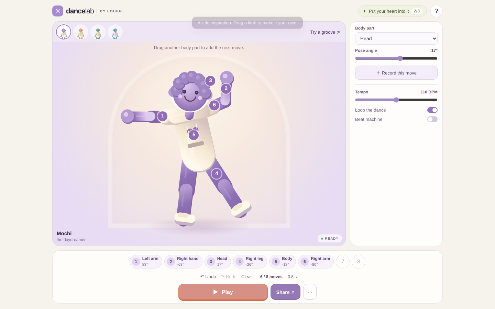

# Share Your Dance · Dance Lab

A fresh implementation of **Share Your Dance**: a lightweight clay choreography studio for Reddit's daily-games hackathon. Drag a body part, record numbered moves, and play your dance. Built-in characters only — no personal-image upload or Reddit-avatar import.



## Start locally (no Reddit account needed)

Use **Node 24 LTS** (Node >=22.12 is supported). From PowerShell, Terminal, or Codex:

```sh
npm ci
npm run dev
```

Open **http://127.0.0.1:5173**. Keep the terminal running; Ctrl+C stops it. `npm run dev` deliberately starts a regular browser preview, not a Reddit authentication flow.

The project uses TypeScript, Vite and the browser's Canvas 2D API. All characters are drawn in code with gradients, articulated joints and numbered markers; there are no external fonts, image downloads or heavy game-engine assets.

## What works

- One-screen layout: the stage, the numbered moves and Play are always visible, with no page scrolling, from small phones to desktop and inside a Reddit post.
- Four clay characters: Mochi, Peach, Pip and Bowie.
- Drag-to-pose editing of ten body parts; numbered sequences of up to eight moves.
- Keyboard-accessible body-part selector and angle slider, plus a record button.
- Undo, redo, clear, selectable timeline steps, example groove.
- Springy playback, tempo, loop and optional locally synthesized beat.
- A daily creative challenge shared by UTC date. Title, required body part and move count (4 to 8) change daily; the same recipe only repeats after 35 days.
- Daily streaks: save or share a dance that completes the challenge. Reddit mode also counts how many dancers finished today, and a scheduled task posts each day's challenge to the subreddit.
- Tap a numbered move to edit it in place.
- Local save/load and validated dance-code copy/import.
- Responsive layouts, reduced idle motion, and accessible labels.
- Separate Devvit build with authenticated Redis drafts and a user-initiated dance-post sharing endpoint.

Tap a numbered move to edit it: the stage shows that pose, and your next drag (or **Update move**) replaces that step instead of adding a new one. Tap it again to go back to adding moves.

## Reddit / Devvit

The GitHub repository and the Devvit app are both named `share-your-dance`.

```sh
npm run login:reddit
npm run build:reddit
npm run dev:reddit
```

Complete Reddit sign-in in your browser. Use a test subreddit where you are a moderator. Follow the CLI's instructions to select/install the app in that subreddit. The subreddit menu item **Open Dance Studio** creates the interactive entry post. The inline card expands to the full studio.

Unlike the local preview, Reddit mode saves drafts through Redis scoped to the app installation. **Share your dance** creates a Reddit post as the signed-in player and opens that post. Its dance is embedded in the post data, so others can play or remix it. Sharing is throttled to one request per user per minute; a failed request may still have created a post, so inspect the subreddit before retrying.

**Status:** local interaction tests and both builds can be verified without credentials. Live Reddit login, installation, post creation, Redis round-trip, and actual app review still require a signed-in Devvit playtest. They must not be claimed as verified just because the build passes. No public Devvit publishing happens automatically.

## Checks

```sh
npm run check
npm run lint
npm test
npm run build
npm run build:reddit
```

Optional browser smoke test:

```sh
npx playwright install chromium
npm run test:ui
```

The smoke test starts/stops its own Vite server on port 5174, checks the desktop/mobile layout and main interactions, and writes screenshots to the parent directory. CI runs unit checks and both builds; browser checks can be run separately.

## Privacy and limits

- No cameras, microphones, uploaded photos, avatar fetching, AI APIs or analytics.
- Local preview saves a single draft on the device; it is not synchronized to Reddit.
- Dance codes contain only a built-in character ID, tempo, and body-part angles.
- Reddit drafts are associated with the authenticated user ID. Shared dances become visible in the selected subreddit.
- This release does not include a community gallery, voting rewards, or video/GIF exports. The daily challenge updates on page load by UTC date.
- Unsaved edits can be lost when the page closes; use Save or copy a dance code.

## Troubleshooting

- **Missing dependencies:** run `npm ci` inside this directory, not its parent.
- **Unsupported Node version:** install Node 24 LTS, reopen the terminal, then reinstall dependencies.
- **Port 5173 in use:** stop the other server, or run `npm run dev -- --port 5175`.
- **Devvit authorization or app-name error:** complete `npm run login:reddit`; confirm the correct Reddit account and app ownership. Never paste tokens/passwords into chat or commit `.env` files.
- **Reddit fails but local works:** collect the actual CLI error. The local preview has no dependency on Reddit permissions.

## Source and license

The choreography model in `src/shared/dance.ts` is adapted from [salahlouffidi/share-your-dance](https://github.com/salahlouffidi/share-your-dance). The interface, Canvas renderer, local runtime, storage flows and integration in this project are new. The original project's BSD-3-Clause license and attribution are retained in `LICENSE`.
